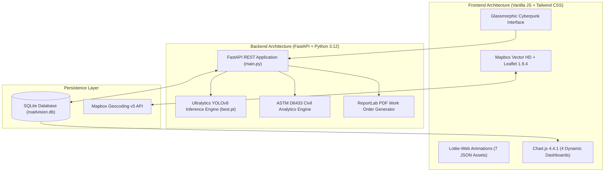

# 🛣️ RoadVision AI — Autonomous Pothole & Road Defect Intelligence Platform

[](https://www.python.org/downloads/)
[](https://fastapi.tiangolo.com)
[](https://ultralytics.com)
[](https://www.astm.org/d6433-20.html)
[](https://mapbox.com)
[](LICENSE)

> **Autonomous full-stack computer vision and civil engineering intelligence platform for automated road distress detection, ASTM D6433 pavement health analytics, Mapbox GIS defect mapping, vehicle cockpit HUD simulation, and municipal work order dispatching.**

---

## 📌 Problem Statement & Deep Civil Context

Degrading road infrastructure—specifically **potholes, fatigue alligator cracking, sub-base rutting, and surface disintegrations**—presents a compounding crisis across global transport networks:

1. **Vehicle Hazards & Commuter Safety:** Unmarked potholes cause catastrophic tire blowouts, rim buckling, suspension collapse, and severe two-wheeler loss of control.
2. **Economic Inefficiency:** Traditional manual surveys require slow, hazardous manual inspections by field crews that record potholes only after structural pavement collapse.
3. **The Exponential Cost of Deferred Maintenance:** According to the **ASTM D6433 Pavement Distress Standard**, pavement loses 40% of its quality in the first 75% of its lifespan, after which it drops precipitously. Repairing a road before the **PCI 55 tipping point** costs **$1x**; deferring maintenance until structural base failure multiplies reconstruction costs by **5.2x**!

**RoadVision AI** solves this problem end-to-end by uniting **deep learning (fine-tuned YOLOv8n)** with **ASTM D6433 civil engineering pavement distress standards**, wrapped in a responsive, glassmorphic dark-cyber web application loaded with **3D card flips, interactive split-comparison sliders, live Lottie animations, and Mapbox Vector HD satellite mapping**.

---

## 🌟 Platform Capabilities & Page Breakdown

The platform consists of **8 integrated modules**:

```
RoadVision AI Platform
├── 1. Home / Mission Center (Interactive Walkthrough, 3D Flip Cards, Lottie Hero)
├── 2. AI Road Vision Studio (Upload, Sample Gallery, Split Slider, BBox Telemetry)
├── 3. Live Dashcam Survey (Video Frame Inference, IoU Tracking & Deduplication)
├── 4. Vehicle Cockpit HUD (Live Webcam / AI Highway Patrol Simulator, Audio Chime)
├── 5. GIS Interactive Defect Map (Mapbox Vector HD, Satellite View, Live GPS, Click-to-Pin)
├── 6. Municipal Command & Kanban (4-Stage Dispatch, Live Financial HUD, ReportLab PDF, CSV)
├── 7. ASTM D6433 PCI Health Analytics (4 Dynamic Charts, What-If Simulator, Corridor Ledger)
└── 8. Citizen Hazard Portal & Tech Specs (Civic GPS Geotagging, Model Benchmarks)
```

---

### 1. 🏠 Home / Mission Overview (`tab-home`)
* **Hero Section:** Features the unboxed, enlarged `roadtrip.json` Lottie animation alongside a high-tech call-to-action banner.
* **Interactive 3D Flip Cards (Click-Anywhere):** Every card can be clicked anywhere on its face to flip seamlessly in 3D space, comparing the **Real-World Road Crisis** against **The RoadVision AI Solution**.
* **Engine Specs & Civil Pillars:** Explains the four cornerstones of the project: Computer Vision, ASTM D6433 Standards, Asphalt Compaction Engineering, and Municipal Dispatch.

### 2. 🔬 AI Road Vision Studio (`tab-studio`)
* **Flexible Ingestion:** Upload custom high-resolution road photographs or test immediately with curated 1-click preset sample road images.
* **Interactive Split-Comparison Slider:** Drag a glowing vertical divider horizontally to compare the raw road surface directly against the real-time AI bounding box segmentation layer.
* **ASTM D6433 Severity Scoring:** Automatically classifies defects into **LOW, MEDIUM, HIGH, or CRITICAL** based on surface area coverage, estimated depth, and pothole cavity diameter.
* **3D Crop Magnifier:** Inspect zoomed-in defect crops with confidence percentages and metric surface area calculations.

### 3. 📹 Live Dashcam Survey & Vehicle HUD (`tab-live`)
* **Frame-by-Frame Inference:** Processes dashcam driving footage at 30 FPS.
* **IoU Tracking & Deduplication:** Tracks pothole centroids across sequential frames to eliminate duplicate detections of the same road pothole.
* **Vehicle Cockpit HUD:** Simulates a highway patrol vehicle cockpit complete with an analog/digital speedometer (MPH/km/h), scanline overlays, crosshair targeting reticles, radar blips, and synthesized audio warning chimes.

### 4. 🗺️ GIS Interactive Road Defect Map (`tab-map`)
* **Mapbox Vector HD Integration:** Powered by the user's Mapbox access token with a **4-way style switcher**:
  * 🌙 **Cyber Night** (`mapbox/navigation-night-v1`): High-contrast neon highways.
  * 🛰️ **Satellite View** (`mapbox/satellite-streets-v12`): Real orbital photography to inspect road asphalt textures from space.
  * 🗺️ **Dark Mode** (`mapbox/dark-v11`): Obsidian cartography.
  * ☀️ **Daylight** (`mapbox/streets-v12`): Full-contrast daytime civil navigation.
* **Mapbox Geocoding v5 Search:** Search any city, street, or landmark worldwide with auto-complete flying navigation.
* **HTML5 Live GPS Locate:** One-click device centering with a pulsing radar ring.
* **Click-to-Pin Defect Mode:** Click anywhere on a road to reverse-geocode the address and log a defect directly into the SQLite database.
* **Glowing Severity Markers:** Color-coded pins with pulsing animations for Critical hazards and direct buttons to advance stage or download ReportLab PDFs.

### 5. 📋 Municipal Maintenance Command & Kanban (`tab-municipal`)
* **Live 4-Stage Civic Pipeline:**
  $$\text{01 · REPORTED} \longrightarrow \text{02 · INSPECTION SCHEDULED} \longrightarrow \text{03 · WORK ORDER ISSUED} \longrightarrow \text{04 · REPAIRED \& CERTIFIED}$$
* **Live Financial & Asphalt HUD:** Dynamically recalculates total active budget in USD (\$) and INR (₹), compacted asphalt tonnage, open tickets, and repaired certifications.
* **Create Work Order Modal:** Dispatcher dialog to log work orders with auto-GPS coordinates, severity ratings, and contractor instructions.
* **Official PDF Audits:** Generates formal, printable municipal engineering audit PDFs using **ReportLab**, featuring official watermarks, hazard metrics, and signature lines.
* **Full Database CSV Export:** One-click download of all work orders in CSV format.

### 6. 📊 ASTM D6433 PCI Health Analytics (`tab-analytics`)
* **Empirical Civil Telemetry Banner:**
  * **Network Mean PCI Score** ($0 - 100$) with dynamic condition rating badge (*Good, Satisfactory, Fair, Poor, Very Poor, Failed*).
  * **Active Defect Backlog Cost** in USD (\$) and INR (₹).
  * **4.2x Preventive Savings Factor:** Capital saved by repairing defects before structural pavement collapse.
  * **Remaining Structural Life:** Modeled remaining years prior to full base failure.
  * **Hot-Mix Asphalt (HMA) Compaction Volume** in metric tons.
* **4 Reactive Visualizations:**
  1. *Defect Severity Breakdown* (Doughnut)
  2. *Corridor PCI Condition vs Repair Cost* (Dual-Axis Bar & Line)
  3. *ASTM D6433 Pavement Life-Cycle Deterioration Curve* (with a live marker showing current network status)
  4. *Civic Work Order Lifecycle Distribution* (Horizontal Bar)
* **Interactive What-If Civil Simulator:** Drag the interactive slider to model how repairing $N$ potholes improves the network's PCI, extends structural lifespan, and prevents deferred reconstruction costs.
* **Corridor Distress Ledger Table:** Comprehensive database ledger with direct PDF downloads.

### 7. 📢 Citizen Hazard Reporting Portal (`tab-citizen`)
* **Crowdsourced Hazard Intake:** Allows commuters to report dangerous road conditions.
* **Auto-GPS Geotagging:** Captures device coordinates with one click.
* **Civic Tracking Ticket:** Generates verifiable ticket IDs (e.g. `CIT-2026-102`) for municipal SLA accountability.

### 8. 🎯 Model Benchmarks & Tech Specs (`tab-specs`)
* **Architecture:** YOLOv8n (Ultralytics Nano Backbone with C2f feature aggregation).
* **Validation Performance:** Tested across 133 unseen test images with 330 pothole instances.
* **Metrics:** **72.1% mAP@50**, **43.7% mAP@50-95**, **76.2% Precision**, **63.3% Recall**.
* **Inference Latency:** Sub-second **150ms** execution on standard CPU.

---

## 🏗️ Technical Architecture & Stack



---

## ⚙️ Installation & Local Setup

### Prerequisites
* **Python 3.10+** (Python 3.12 recommended)
* **Git** installed on your machine

### 1. Clone the Repository
```bash
git clone https://github.com/charvibaliji373/Pothole-and-road-defect-detector.git
cd Pothole-and-road-defect-detector
```

### 2. Create and Activate a Virtual Environment
```bash
# Windows (PowerShell)
python -m venv venv
.\venv\Scripts\Activate.ps1

# Linux / macOS
python3 -m venv venv
source venv/bin/activate
```

### 3. Install Dependencies
```bash
pip install -r requirements.txt
```

### 4. Run the Application
```bash
python run_app.py
```

The unified launcher will boot the FastAPI server and serve the glassmorphic frontend:
* **Web Application:** `http://127.0.0.1:8000`
* **Interactive Swagger API Documentation:** `http://127.0.0.1:8000/docs`

---

## 📡 REST API Reference

| Endpoint | Method | Description |
| :--- | :--- | :--- |
| `/api/health` | `GET` | Service status, device (CPU/CUDA), and model status |
| `/api/model-info` | `GET` | Model architecture, mAP@50, precision, recall, and benchmarks |
| `/api/samples` | `GET` | List curated sample test road images |
| `/api/detect/image` | `POST` | Core image detection, bounding boxes, ASTM metrics, and crops |
| `/api/detect/video` | `POST` | Video survey detection with IoU centroid tracking and deduplication |
| `/api/inspections` | `GET` | Retrieve all surveyed road defect records from SQLite |
| `/api/inspections/{uuid}` | `GET` | Detailed telemetry for a specific inspection / work order |
| `/api/inspections/{uuid}/update-status` | `POST` | Advance status (`Reported` $\rightarrow$ `Scheduled` $\rightarrow$ `Work Order` $\rightarrow$ `Repaired`) |
| `/api/inspections/{uuid}/pdf` | `GET` | Download official ReportLab PDF work order audit report |
| `/api/inspections/{uuid}/csv` | `GET` | Download CSV telemetry specification for a work order |
| `/api/municipal/work-orders` | `POST` | Manually dispatch a new civil work order into the pipeline |
| `/api/gis/defects` | `GET` | GeoJSON FeatureCollection of all road hazards for Mapbox |
| `/api/gis/log-defect` | `POST` | Log a defect directly from clicking on a road on the Mapbox layer |
| `/api/analytics/pci-stats` | `GET` | Deep ASTM D6433 empirical analytics, deterioration curves, and ledger |
| `/api/citizen/report` | `POST` | Submit public civic hazard report with GPS coordinates |
| `/api/citizen/reports` | `GET` | List all citizen hazard submissions |

---

## 🎨 Asset Structure

```
├── backend/
│   ├── app/
│   │   ├── config.py           # Path configuration and constants
│   │   ├── database.py         # SQLite3 database schema & ASTM D6433 analytics
│   │   ├── detector.py         # YOLOv8 inference, IoU tracking & civil math
│   │   ├── main.py             # FastAPI REST endpoints
│   │   ├── models.py           # Pydantic schemas
│   │   └── report_generator.py # ReportLab PDF & CSV generation engine
│   ├── data/
│   │   └── roadvision.db       # Seeded SQLite database with real road audits
│   ├── models/
│   │   ├── best.pt             # Fine-tuned YOLOv8n pothole weights
│   │   └── yolov8n.pt          # Base YOLOv8 nano model
│   └── samples/                # Curated preset test road photographs
├── frontend/
│   ├── css/
│   │   ├── animations.css      # 3D flip card, radar sweep, glow & pulse keyframes
│   │   └── style.css           # Glassmorphism, cyber gradients, HUD crosshairs
│   ├── js/
│   │   ├── app.js              # Application orchestrator & ASTM D6433 Chart.js engine
│   │   ├── detector.js         # AI Studio split-comparison slider & uploads
│   │   ├── live_hud.js         # Cockpit HUD simulator, speedometer & Web Audio chime
│   │   ├── map.js              # Mapbox Vector HD controller & geocoding
│   │   ├── municipal.js        # 4-stage Kanban lifecycle, modals & CSV export
│   │   └── tilt.js             # Vanilla tilt perspective mouse-following sheen
│   └── index.html              # Master glassmorphic single-page web app
├── public/                     # 7 Full-size Lottie animation files
│   ├── analysis.json           # PCI Health Analytics animation
│   ├── camera.json             # Live Vehicle Cockpit HUD animation
│   ├── detection.json          # AI Detection Studio animation
│   ├── manage.json             # Municipal Kanban animation
│   ├── map.json                # GIS Map animation
│   ├── model.json              # Model Specs animation
│   ├── report.json             # Citizen Portal animation
│   └── roadtrip.json           # Home Hero section animation
├── requirements.txt            # Python dependencies
└── run_app.py                  # Unified local application launcher
```

---

## 📄 License & Attribution

Distributed under the **MIT License**. Engineered for modern civil departments, smart city infrastructure authorities, and transportation engineering teams.
